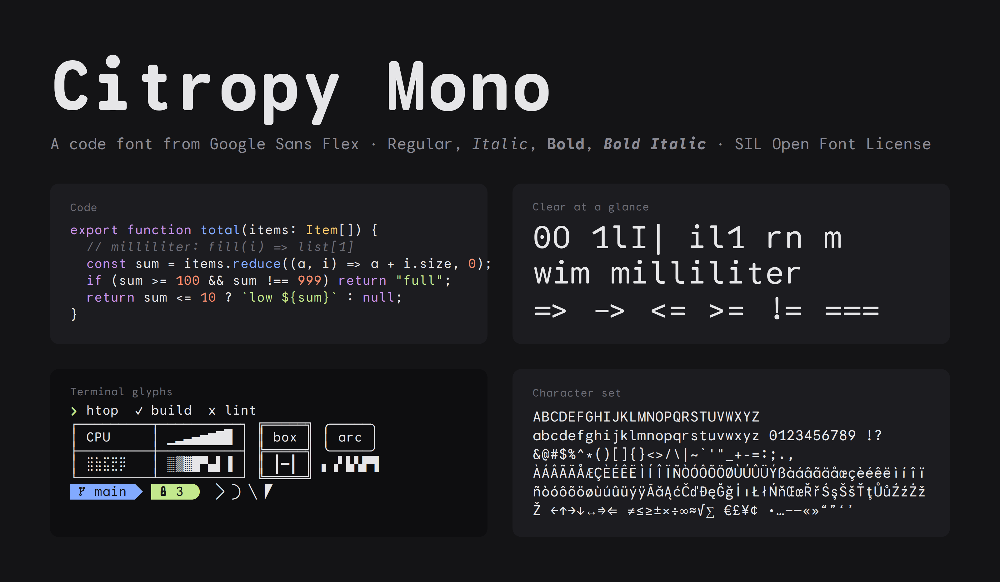

# Citropy Mono

A monospaced code font built from Google Sans Flex, made for [Citropy](https://github.com/tinuxongit/Citropy).



- **Clear at a glance:** `0` and `O`, `1`, `l`, `I` and `|` all look different.
- **Texture healing:** wide letters like `m` and `w` take a little room from narrow neighbours like `i` and `l`, so `milliliter` doesn't look cramped.
- **Joined operators:** `=>`, `->`, `!=`, `===`, `<=` and `>=` draw as single shapes but keep one character per cell.
- **Italic:** built from Google Sans Flex's own slant, with a cursive `i`.
- **Terminal glyphs:** box drawing, blocks, shades, braille and Powerline symbols fill the whole cell, so lines meet across rows.
- **Hinted** with ttfautohint for sharp text on Windows and Linux.

Four styles: Regular, Italic, Bold and Bold Italic. Covers Latin, Latin Extended, arrows, math and common symbols.

## Install

Download the zip from the [latest release](../../releases/latest) and install the TTF files in `fonts/ttf`:

- **macOS:** open each file and click Install Font.
- **Windows:** right-click the files and choose Install.
- **Linux:** copy them to `~/.local/share/fonts` and run `fc-cache -f`.

Then set your editor's font to `Citropy Mono`. The joins and texture healing use the `calt` feature, so turn ligatures on. In VS Code that's `"editor.fontLigatures": true`.

## Use on the web

The WOFF2 files are in `fonts/webfonts`:

```css
@font-face {
  font-family: "Citropy Mono";
  src: url("CitropyMono-Regular.woff2") format("woff2");
  font-weight: 400;
  font-style: normal;
  font-display: swap;
}
```

Add one rule per style, with `font-weight: 700` for bold and `font-style: italic` for italic.

## Build

The fonts are generated from the pinned Google Sans Flex and Google Sans Code releases in [google/fonts](https://github.com/google/fonts). The script downloads them, so the sources aren't stored here.

```sh
pip install -r requirements.txt
python build.py
```

It takes about two minutes and writes `fonts/ttf`, `fonts/webfonts` and `OFL.txt`. Pass style names to build only some, like `python build.py Regular "Bold Italic"`.

## License

Citropy Mono is licensed under the [SIL Open Font License 1.1](OFL.txt). It's a modified version of [Google Sans Flex](https://github.com/googlefonts/googlesans-flex), with symbols from [Google Sans Code](https://github.com/googlefonts/googlesans-code), both also under the OFL.
